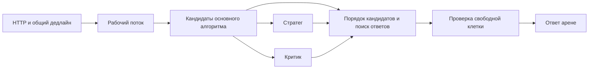

# Два локальных советника в боте 0.5.0

## Архитектура

Арена присылает полную позицию. Рабочий поток строит доску, генерирует допустимые ходы и моделирует окружения. Советники независимо оценивают тот же корневой кандидат. Веса загружаются с диска. Между игровым запросом и ответом нет обращения к внешней службе.



## Стратег

Логистическая регрессия оценивает, похож ли кандидат на выбранный победителем ход. Положительный пример — реальный ход победившей стороны. Для каждого такого хода берётся одна другая свободная клетка как отрицательный пример. Данные отражают предпочтения игроков. Метка ничего не говорит об абсолютной оптимальности хода.

## Критик

Вторая регрессия обучена на ходах обеих сторон. Цель равна единице, если точка мертва через восемь последующих полуходов. Последние восемь ходов каждой партии исключаются из этой задачи. Выход показывает риск для одной точки. Для угрозы всей группе используются моделирование правил и ответный поиск. Критик может понизить привлекательный для стратега ход.

## Арбитр

В корне ранг включает позиционную оценку, немедленный захват, гибель поставленной точки и прибавку советников. Стратег добавляет 12 × вероятность выбора, критик вычитает 18 × вероятность потери. Для сравнения, множитель немедленного захвата равен 6500. Рейтинг определяет порядок и отбор кандидатов. Среди рассмотренных ветвей выбор зависит от худшего смоделированного ответа. Срочная тактика и полностью решённый эндшпиль могут закончить поиск до вызова моделей. Сервер проверяет границы и занятость перед записью в кэш.

## Выбор технологии

| Подход | Стоимость и развёртывание | Задержка и ограничения |
|---|---|---|
| Две локальные регрессии | 12 коэффициентов, CPU, стандартный Node.js | Два скалярных произведения. Локальные признаки упускают длинные цепочки |
| Свёрточная policy/value-сеть | Потребуются отдельное обучение, веса, совместимый runtime | Видит больше доски. Загрузку модели в каждый новый worker придётся заменить пулом и измерить |
| Внешний API | Сеть, учётные данные, стоимость вызова | Задержка зависит от провайдера. Для игрового пути потребуются отмена и изоляция |
| Поиск с правилами | Уже входит в проект | Точно воспроизводит захваты конечного поля. Глубина ограничена временем и шириной |

## Подключение и контракт

Вход в основной алгоритм — `chooseMove(request, { advice, checkpoint })`. Функция `adviser(weights, mode)` возвращает синхронный обработчик `(board, index, width, height) => number`. Кодировки доски — 0 для пустой клетки, 1 и 2 для живых своих и чужих точек, 3 и 4 для мёртвых. Индекс равен `y * width + x`.

Пять признаков идут в фиксированном порядке: число своих и чужих живых соседей по вертикали и горизонтали, число своих и чужих живых соседей по диагонали, признак края. В каждой строке весов первым стоит свободный коэффициент, затем пять коэффициентов признаков. Изменение их порядка требует повторного обучения обоих советников. Из истории партии в оперативную оценку попадает состояние точек. Название команды не влияет на оценку.

## Форматы и сообщения

Файл `ai/weights.json` содержит массивы `policy` и `risk`. Каждый состоит из шести конечных чисел. Отсутствующая или повреждённая строка отключает соответствующую модель. Внутри worker сообщение `{move}` сохраняет промежуточный выбор, `{final:true,move}` завершает вычисление. У клиента остаётся прежний HTTP-контракт, например `{"x":13,"y":0}`. Для заполненного поля сервер возвращает 409, для неверного формата — 400, для незаконченной загрузки по истечении срока — 408.

## Время и отмена

Настройка `MAX_RESPONSE_TIME_MS` по умолчанию равна 2000. Сервер применяет минимум из этой настройки, лимита арены и остатка часов. Из него вычитаются уже прошедшее время и резерв до 50 мс, максимум 10% бюджета с округлением вверх. Резерв нужен для завершения потока, проверки, сериализации и записи ответа. При замерах на localhost запас сравнивался с накладными расходами запуска потока и HTTP; при смене хоста следует повторить замер. Клиентская сеть за пределами процесса может добавить задержку.

Обе оценки выполняются последовательно в одном потоке. Создание двух дополнительных потоков для двенадцати коэффициентов не оправдано. При долгом расчёте родитель завершает общий worker. Отмена запроса завершает его независимо от текущего этапа.

## Ошибки и конфигурация

| Условие | Поведение |
|---|---|
| DOTS_AI_MODE=autonomous или настройка отсутствует | Загружается только собственный алгоритм |
| DOTS_AI_MODE=strategist или critic | Включается указанная модель |
| DOTS_AI_MODE=hybrid | Работают обе доступные модели |
| Нет каталога ai, отсутствует файл весов, ошибка чтения или синтаксиса JSON | Обычный поиск продолжает работу |
| Одна строка весов повреждена | Вторая проходит собственную проверку |
| Интернет недоступен или нет API-ключа | Локальное вычисление работает |
| Worker превысил срок | Сервер использует последнего переданного кандидата или свободную клетку |
| Оба советника предпочли плохой ход | Симуляция может отклонить его при проверке ответов |

## Обучение с нуля

Для подготовки данных нужны Python 3, Node.js и копия движка правил. Из корня проекта:

```sh
export DOTS_ENGINE="$PWD/tests/support/arena-reference.mjs"
python3 scripts/read-replays.py игры.zip /tmp/replays.json
node scripts/train-advisers.mjs /tmp/replays.json /tmp/weights.json > /tmp/audit.json
node scripts/review-replays.mjs /tmp/replays.json /tmp/audit.json
```

Первый шаг сверяет одинаковые идентификаторы турнирных файлов. Журналы HTTP учитываются отдельно. Второй шаг воспроизводит последовательность и проверяет итог обоих цветов. Обе партии одной пары соперников целиком попадают в одну выборку. На данном корпусе 30 партий отведены обучению, по шесть — валидации и тесту. Параметры подгоняются пакетным градиентным спуском с L2-регуляризацией. Отчёт выводит ошибку Брайера для обеих отложенных выборок и постоянный прогноз для сравнения.

Сохраните предыдущие веса. Для испытаний в рабочей копии замените ai/weights.json полученным файлом и повторите проверки ниже. Боевой сервер ничего не переобучает во время матча. Для нового турнира лучше отложить целый турнир и проверить повторения ходов между экспортами.

## Тестирование и проверка изменений

```sh
export DOTS_ENGINE="$PWD/tests/support/arena-reference.mjs"
npm test
DOTS_AI_MODE=hybrid node scripts/benchmark-http.mjs /tmp/replays.json
DOTS_SIZES=8 DOTS_PAIRS=8 DOTS_PLAYER=ai/hybrid.js DOTS_OPPONENTS=current node tests/selfplay.mjs
node scripts/profile-matches.mjs /tmp/replays.json
```

Повторите HTTP-замер для autonomous, strategist и critic. Для сравнения с исходным сервером третьим аргументом команды benchmark передайте путь к его server/index.js. Проверяйте ошибки, максимум и p99, процент резервных ответов, результат со сменой цвета. Для двух советников отдельно полезна ошибка Брайера на новых партиях. Она измеряет качество прогноза, а силу игры показывают матчи.

## Развёртывание и откат

В окружении процесса или корневом .env задайте режим и лимит. Запустите `npm start`, проверьте GET /v1/health и POST /v1/move. Для Docker Compose порядок приведён в [инструкции запуска](RUNBOOK.md). Откат режима — DOTS_AI_MODE=autonomous и перезапуск. Ключи API для этих моделей не нужны.

## Дальнейшее развитие

Первый кандидат на расширение признаков — распределение угроз по группам. Для критика отдельно стоит проверить риск потери всей группы через несколько ответов. Собирайте новые турниры, сравнивайте на более позднем турнире и проводите парные матчи против исполняемого соперника при доступности. Вводить более тяжёлую модель имеет смысл после измерения времени загрузки и серии сравнений с текущим автономным поиском.
